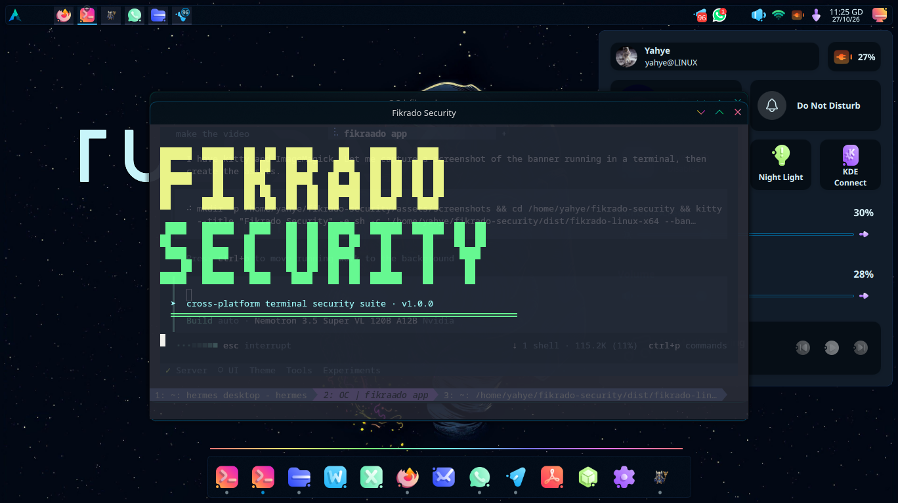

# 🟡🟢 Fikrado Security

> Cross-platform **terminal-only** security suite — malware scan & removal, network discovery, server hardening audit, Active Directory checks, and AI-assisted detection.  
> Zero runtime dependencies. Runs on **Linux, macOS, and Windows** with prebuilt standalone binaries.

<div align="center">

[](https://github.com/fikrado2/fikrado-security-cli/releases/latest)
[](https://github.com/fikrado2/fikrado-security-cli/tags)
[](LICENSE)
[](https://nodejs.org/)
[](https://github.com/fikrado2/fikrado-security-cli/releases)
[](https://openrouter.ai/)
[](https://platform.openai.com/)
[](https://opencode.ai/)

</div>

---

## 🎬 Preview

### Startup banner

The animated **FIKRADO SECURITY** ASCII banner in yellow + light green, followed by the interactive terminal menu:



### Interactive menu

Full terminal UI with colors, spinners, progress bars, and tables:


---

## ⚡ Features

| 🟡 Engine | What it does |
|-----------|-------------|
| **🛡️ Malware scanner** | 19 built-in signature families + filename heuristics: EICAR test file, obfuscated PHP/ASP/JSP webshells, reverse shells, encoded PowerShell, Mimikatz/Meterpreter artifacts, crypto-miners, `.htaccess` auto-prepend, autorun worms, obfuscated JS. Quarantine, restore, or permanently delete findings. |
| **🌐 Network scanner** | Subnet discovery, cross-platform ping sweep (64 parallel probes), TCP scan of 48 service ports, severity-ranked risk flags (Telnet, SMB, RDP, Redis, MongoDB, Elasticsearch, Docker API, memcached, TR-069…), deep port scan of a single host (1–1024). |
| **🖥️ Server / host audit** | Linux: SSH root/password login, `/etc/shadow` perms, UID-0 accounts, empty passwords, world-writable `/etc`, SUID inventory, firewall, fail2ban, auto-updates, `ld.so.preload` rootkit check, suspicious cron, `authorized_keys`.<br>Windows: Defender, firewall profiles, UAC, RDP, Guest, SMBv1, PowerShell policy.<br>macOS: application firewall, FileVault, SIP, Gatekeeper, remote login. |
| **🏢 Active Directory audit** | DC discovery via DNS SRV (`_ldap._tcp.dc._msdcs`), Kerberos/LDAP/LDAPS/GC/SMB posture, and a **real anonymous LDAP bind probe** (raw BER, zero dependencies) to detect anonymous directory access. |
| **🤖 AI detection** | Sends findings/reports to any OpenAI-compatible endpoint — **OpenRouter, OpenAI, OpenCode Zen, or custom** (Groq, Ollama, LM Studio, Together…) — returns classification, risk, and recommended action. Optional; you opt in per scan. |

Everything is **read-only** except the malware actions you explicitly request (quarantine or delete).

---

## 📦 Install

### Option A — Prebuilt standalone binary (no Node.js needed)

Download the file for your OS from the **[Releases](https://github.com/fikrado2/fikrado-security-cli/releases)** page:

| Platform | File |
|----------|------|
| 🐧 Linux x86_64 | `fikrado-linux-x64` |
| 🐧 Linux ARM64 | `fikrado-linux-arm64` |
| 🍎 macOS Intel | `fikrado-macos-x64` |
| 🍎 macOS Apple Silicon | `fikrado-macos-arm64` |
| 🪟 Windows x64 | `fikrado-win-x64.exe` |

```bash
# Linux / macOS
chmod +x fikrado-linux-x64
sudo mv fikrado-linux-x64 /usr/local/bin/fikrado
fikrado
```

```powershell
# Windows (PowerShell)
.\fikrado-win-x64.exe
```

> 🍎 macOS may block an unsigned binary. Clear the quarantine flag once:
> `xattr -d com.apple.quarantine ./fikrado-macos-arm64 && chmod +x ./fikrado-macos-arm64`
>
> 🪟 Windows SmartScreen may warn — choose **More info → Run anyway**.

### One-line installer (Linux / macOS)

```bash
curl -fsSL https://raw.githubusercontent.com/fikrado2/fikrado-security-cli/main/install.sh | bash
```

Installs to `~/.local/bin/fikrado` (override with `FIKRADO_PREFIX`).

### Option B — From source (requires Node.js ≥ 16)

```bash
git clone https://github.com/fikrado2/fikrado-security-cli.git
cd fikrado-security
node bin/fikrado.js          # no npm install needed to run
```

> 📦 npm: the package is not yet published to the npm registry. Use the binary or source options above.

---

## 🚀 Quick start

Run with no arguments for the animated menu:

```bash
fikrado
```

Common one-liners:

```bash
fikrado scan ~/Downloads                      # scan a folder, report only
fikrado scan /var/www --quarantine            # move threats to ~/.fikrado/quarantine
fikrado scan /var/www --delete                # permanently delete detected threats
fikrado net 192.168.1.0/24                    # subnet + port scan
fikrado net --deep 10.0.0.5                   # full port scan of one host
fikrado server                                # host hardening audit
fikrado ad corp.example.com                   # Active Directory audit
fikrado full                                  # host audit + malware + network
fikrado quarantine list                       # inspect quarantined files
fikrado quarantine restore 1                  # put item 1 back
fikrado report list                           # list saved reports
fikrado report show 1                         # print a report
```

---

## 🎛️ CLI reference

```
fikrado                          interactive menu (banner + animated UI)
fikrado scan [path] [--delete|--quarantine] [--ai] [--no-report]
fikrado net [cidr] [--deep <host>] [--ai] [--no-report] [--yes]
fikrado server [--ai] [--no-report]
fikrado ad <domain> [--ai] [--no-report]
fikrado full                       # host audit + malware + network
fikrado quarantine [list|restore <n>]

fikrado keys                     interactive AI settings
fikrado keys list
fikrado keys set <provider> [key]
fikrado keys model <provider> <model>
fikrado keys base <provider> <url>
fikrado keys test [provider]
fikrado keys off

fikrado report [list|show <n>|folder]
fikrado --banner [--static] | --help | --version
```

**Flags**

| Flag | Meaning |
|------|---------|
| `--ai` | Send results to the active AI provider for analysis |
| `--delete` | Permanently delete detected malware (scan only) |
| `--quarantine` | Move detected malware into quarantine (scan only) |
| `--no-report` | Do not write a report file |
| `--deep <host>` | Full port scan of one host (net only) |
| `--yes` | Skip confirmation for subnets larger than /24 |
| `--no-anim` | Disable animations |
| `NO_COLOR=1` | Disable colors |

Providers: `openrouter` · `openai` · `opencode` · `custom`

---

## 🤖 AI detection

AI analysis is optional and local-first: data is only sent to the provider you configure, and only when you ask (`--ai` or the *Analyze with AI?* prompt).

### Add a key

```bash
fikrado keys set openrouter sk-or-v1-...      # https://openrouter.ai/keys
fikrado keys set openai sk-...                # https://platform.openai.com/api-keys
fikrado keys set opencode <zen-key>           # OpenCode Zen
fikrado keys set custom <key>                 # any OpenAI-compatible endpoint
```

Or from the interactive menu: **6 → provider → Set API key** (input is hidden).

Manage providers:

```bash
fikrado keys list
fikrado keys test
fikrado keys model openai gpt-4o-mini
fikrado keys base custom http://localhost:11434/v1
fikrado keys off                              # disable AI completely
```

Keys are stored **only** on your machine in `~/.fikrado/config.json` (mode `0600`). They are never sent anywhere except the provider you configured.

---

## 📁 Reports, quarantine & data

Everything lives under `~/.fikrado/`:

```
~/.fikrado/
├── config.json          # AI providers + settings (chmod 600)
├── signatures.json      # optional custom signatures
├── quarantine/          # quarantined files + manifest.json
└── reports/             # fikrado-<kind>-<timestamp>.json and .txt
```

**Custom signatures** — drop a JSON array into `~/.fikrado/signatures.json`:

```json
[
  { "id": "MY.RULE", "name": "My rule", "severity": "high",
    "pattern": "eval\\s*\\(\\s*base64_decode", "flags": "i" }
]
```

**Quarantine** — files are moved (not copied) into `~/.fikrado/quarantine/` and recorded in `manifest.json` with original path, matched signatures, and timestamp. Restore with `fikrado quarantine restore <n>`. Quarantined files are not executed or re-scanned.

**Reports** — every scan writes a human-readable `.txt` and a machine-readable `.json` with host, platform, user, duration, and findings. Use `--no-report` to skip.

---

## 🚪 Exit codes

| Code | Meaning |
|------|---------|
| `0` | Success, nothing wrong found |
| `1` | Usage error / runtime failure |
| `2` | Findings: malware detected (`scan`) or failing checks (`server`) |
| `130` | Interrupted (Ctrl+C) |

Useful for cron/CI:

```bash
fikrado scan /var/www --delete --no-report || echo "FIKRADO: threats handled"
```

---

## 🔨 Build standalone binaries

```bash
npm install                 # dev dependency: @yao-pkg/pkg
npm run build               # all platforms → dist/
```

Output (plus `dist/SHA256SUMS.txt`):

```
dist/fikrado-linux-x64
dist/fikrado-linux-arm64
dist/fikrado-macos-x64
dist/fikrado-macos-arm64
dist/fikrado-win-x64.exe
```

Binaries are self-contained (Node runtime embedded) and need nothing installed on the target machine. Building all targets from one machine works because pkg downloads the official Node base binaries for each platform.

The repository also ships a GitHub Actions workflow that builds and attaches all binaries to a release when you push a tag:

```bash
git tag v1.0.0 && git push origin v1.0.0
```

---

## 🛠️ Development

```bash
npm test              # 23 tests, Node's built-in runner
npm start             # run from source
npm run banner        # render the banner only
```

```
bin/fikrado.js            CLI entry
lib/menu.js               interactive UI + argument parsing
lib/ui.js                 colors, banner animation, spinner, progress bar, tables
lib/config.js             ~/.fikrado config, providers, custom signatures
lib/ai.js                 OpenAI-compatible chat client
lib/report.js             report store (json + txt)
lib/scanners/malware.js   signature engine + quarantine/delete/restore
lib/scanners/network.js   CIDR/ping/port scanning + risk table
lib/scanners/server.js    cross-platform hardening checks
lib/scanners/ad.js        AD discovery + raw LDAP anonymous bind probe
test/                     unit + integration tests
scripts/build-binaries.js standalone binary builder
```

---

## ⚠️ Safety & legal

- Use Fikrado Security **only on systems you own or are explicitly authorized to test**. Port-scanning or auditing networks without permission can be illegal.
- The malware engine is **signature-based**, not a replacement for a full antivirus/EDR. It is tuned for webshells, droppers, reverse shells, miners, and common post-exploitation artifacts.
- `--delete` is irreversible. Prefer `--quarantine` when unsure.
- Some host checks need root/administrator to read `/etc/shadow`, firewall state, or registry keys; without it they report `info`/`skip` instead of failing.
- AI analysis sends finding metadata (file names, signature IDs, short snippets) to your chosen provider. Do not enable it on data you cannot share.

---

## 📄 License

MIT — see [LICENSE](LICENSE).

---

<div align="center">

**Built by [fikrado2](https://github.com/fikrado2)** — Stay secure. 🟡🟢

[](https://github.com/fikrado2/fikrado-security-cli/stargazers)
[](https://github.com/fikrado2/fikrado-security-cli/network/members)
[](https://github.com/fikrado2/fikrado-security-cli/watchers)

</div>